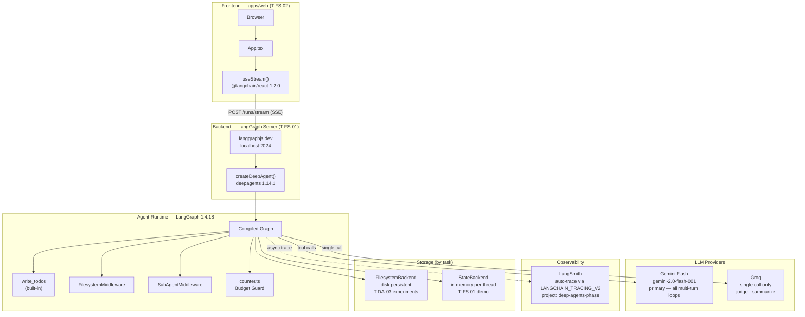
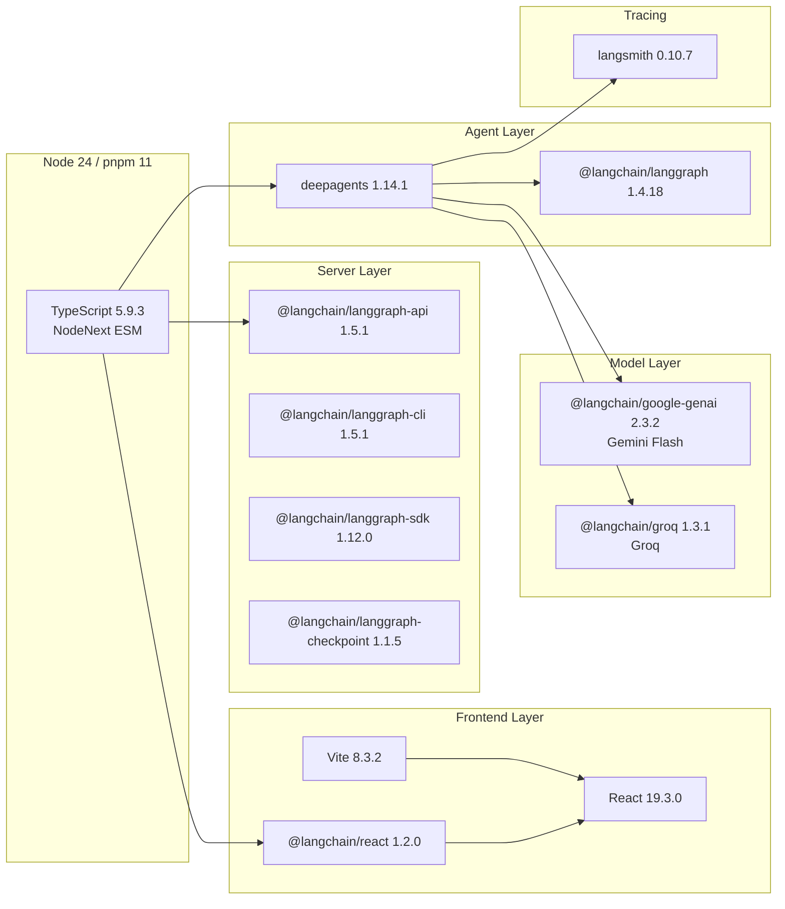
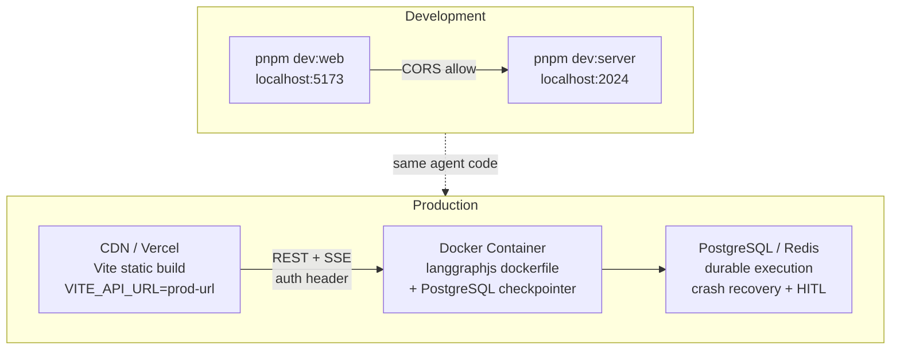

# High-Level Architecture

The complete system across all three phases: core agent harness (T-DA), LangGraph Server backend (T-FS-01), and React frontend (T-FS-02).

## System Overview

## Technology Stack

## Deployment Topology (T-FS-03)

