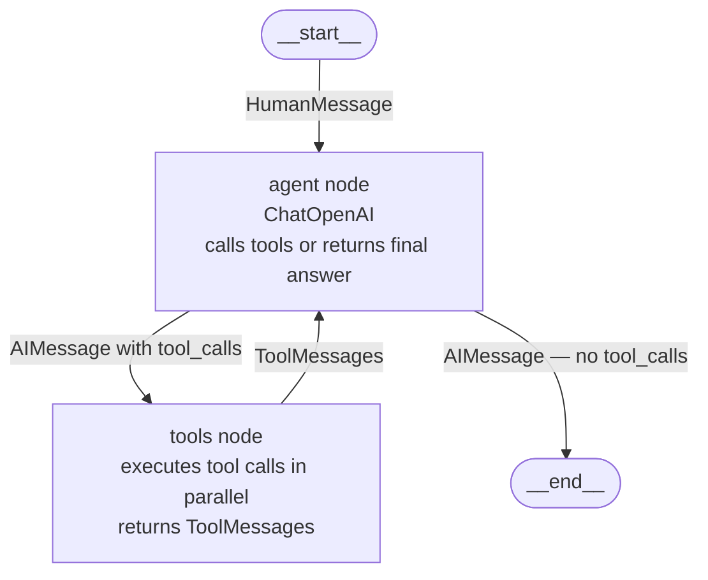
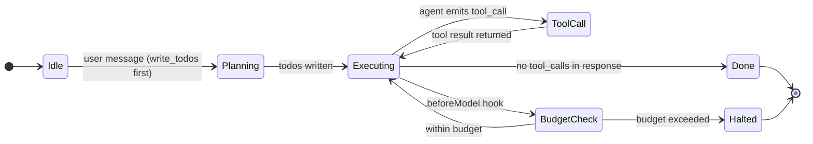
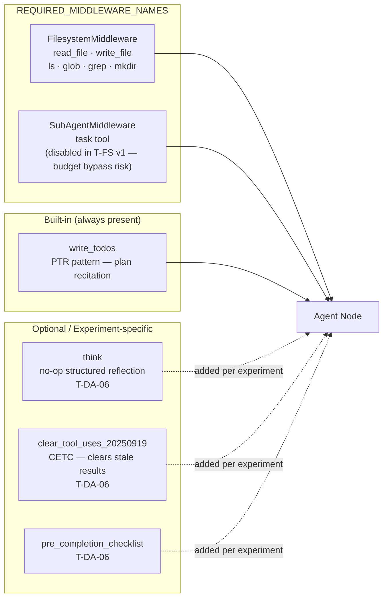
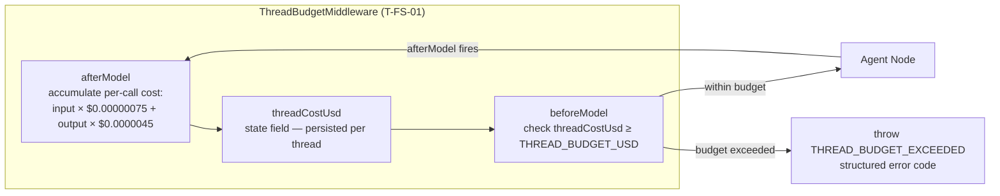
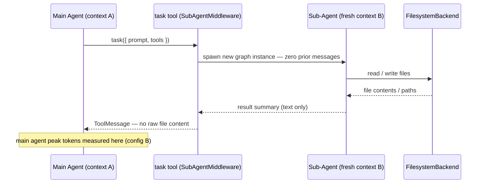

# Agent Graph

Internal structure of the LangGraph graph that `createDeepAgent()` compiles. DeepAgents wires the nodes; we configure via options passed in.

## Graph Node Structure

## State Machine

## Built-in Tools (deepagents 1.14.1 defaults)

## Budget Guard (BGA Pattern) — ThreadBudgetMiddleware

> **T-DA experiments** use `counter.ts` (4 dims: tokens / cost / ms / calls) as a run-level observer. `ThreadBudgetMiddleware` is the server-side enforcement layer for T-FS-01+.

## Sub-Agent Isolation (CIP Pattern) — task tool

