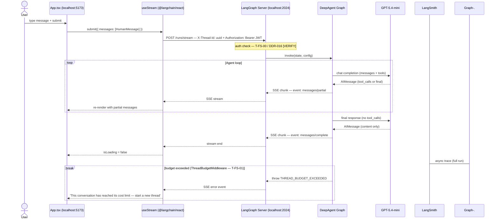
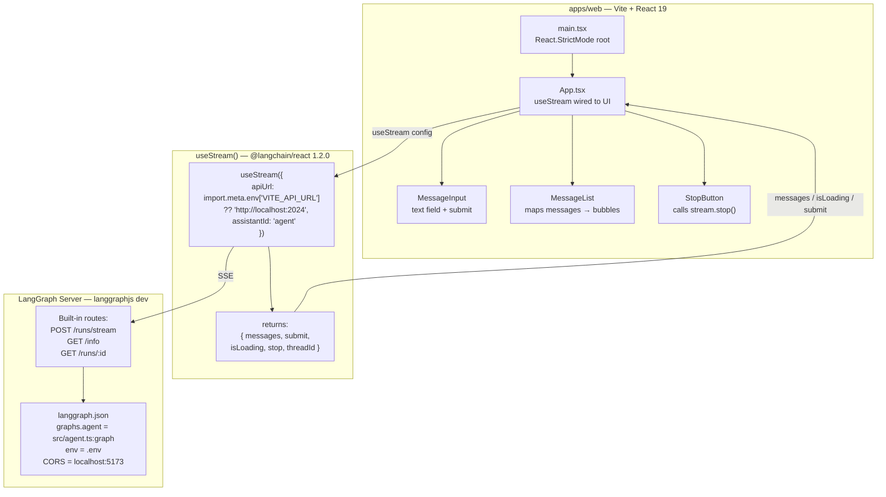
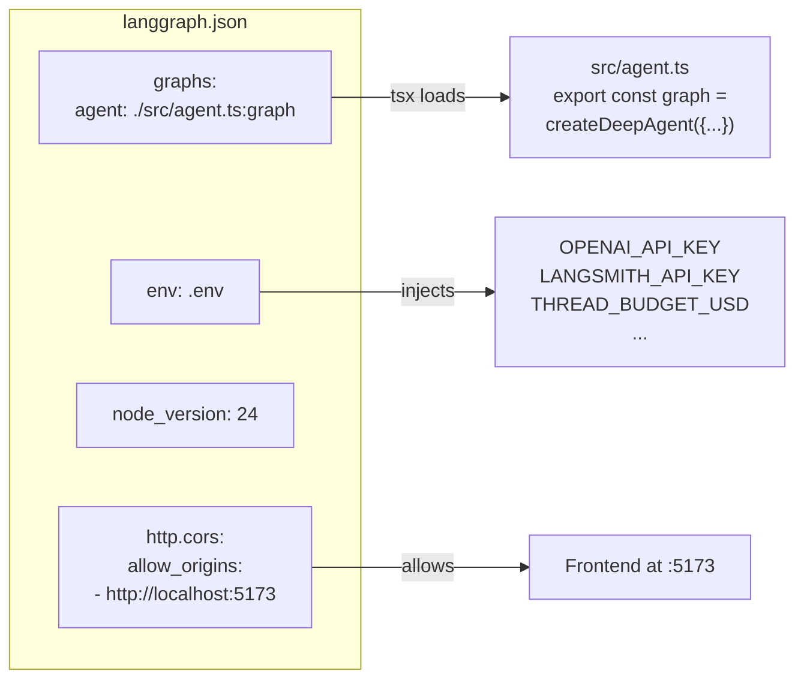
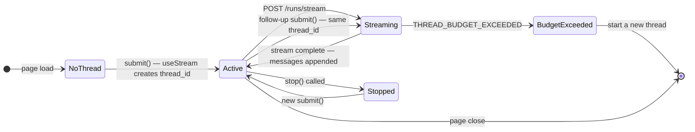

# Fullstack Architecture

How the React frontend (T-FS-02) connects to the LangGraph Server backend (T-FS-01) and streams responses. Auth baseline defined in T-FS-00.

## Request / Response Flow

## Component Architecture

## langgraph.json Structure

## Thread Lifecycle

