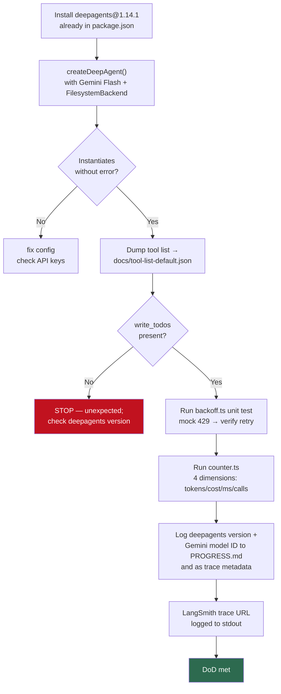
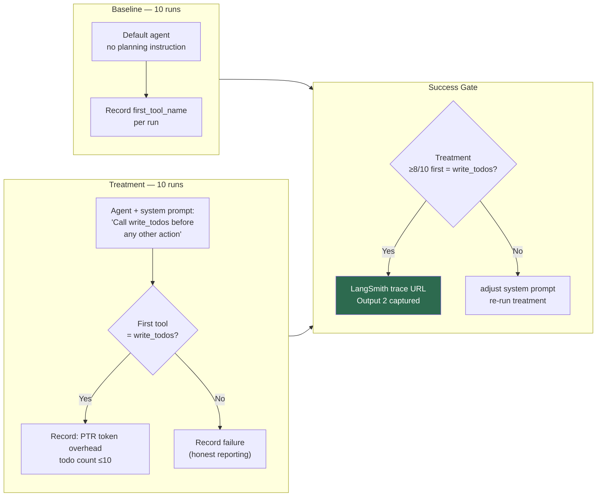
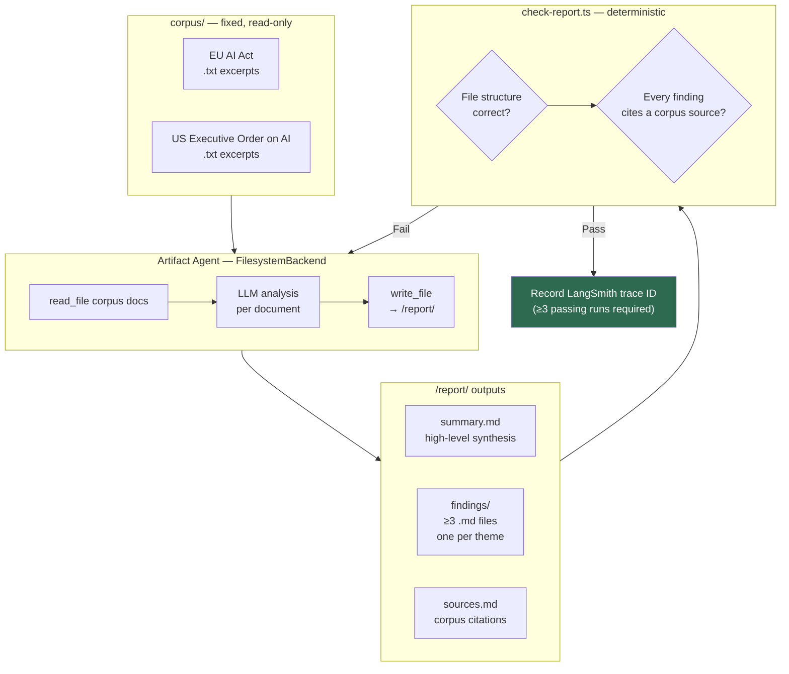
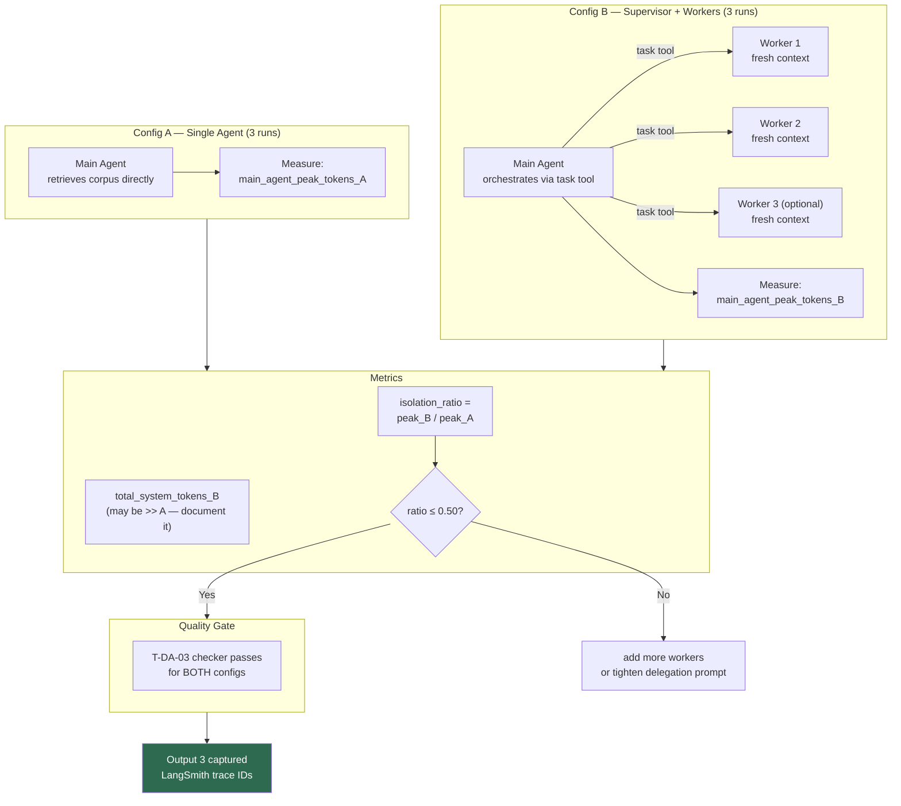
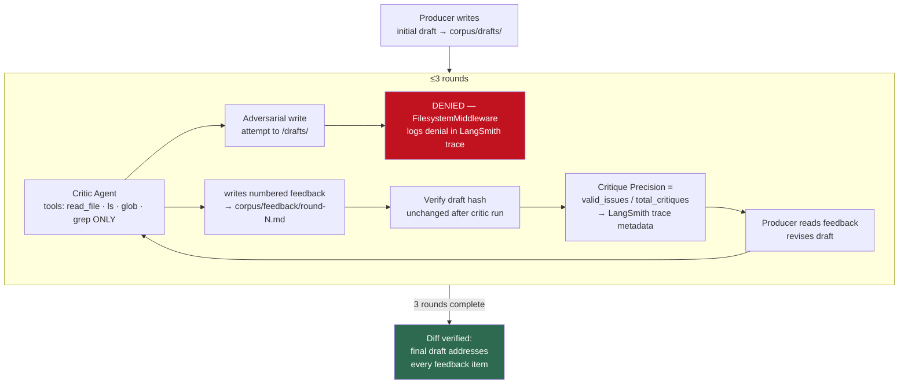
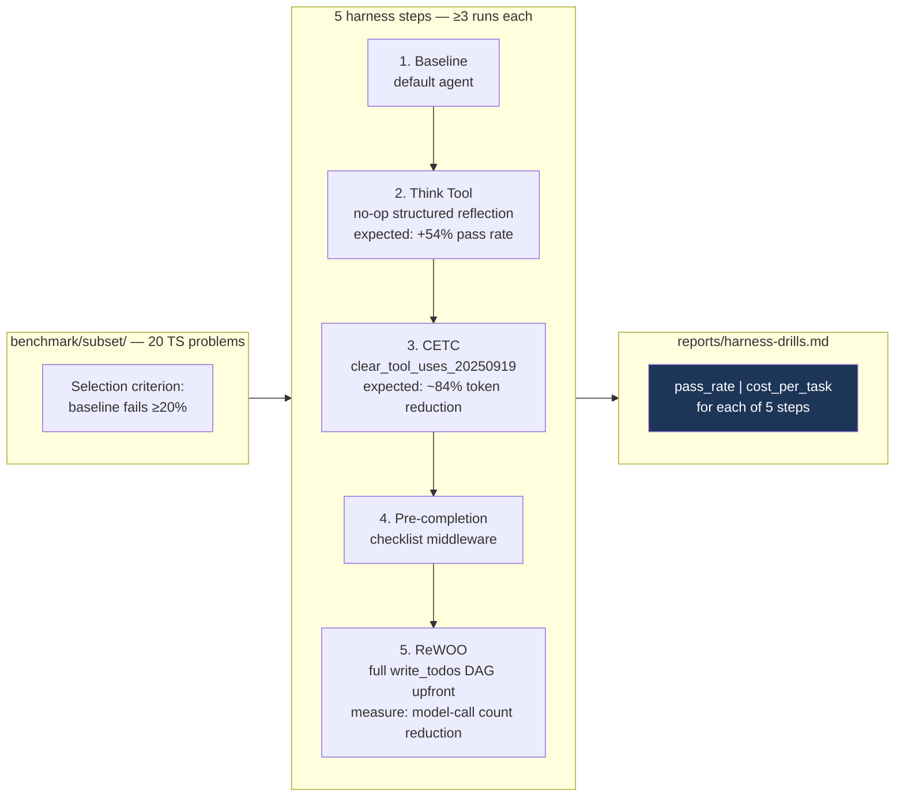
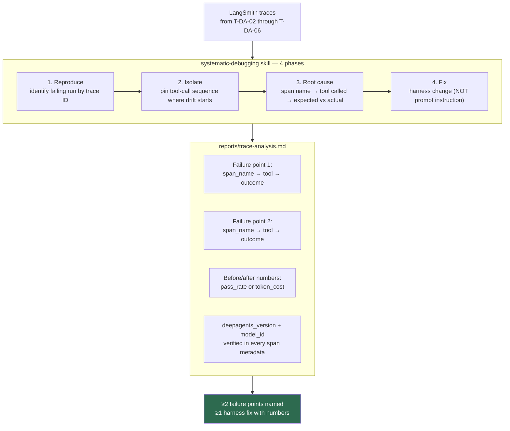

# Experiment Workflows

One diagram per experiment task (T-DA-01 through T-DA-07). Each shows the run loop, measurement points, and success gate.

## T-DA-01 — Scaffold + Reality Check

## T-DA-02 — Planning-First (Output 2)

## T-DA-03 — Artifact Agent (Output 1)

## T-DA-04 — Context Isolation Proof (Output 3)

## T-DA-05 — Critique Workflow

## T-DA-06 — Harness Optimization Drills

## T-DA-07 — Trace Analysis

