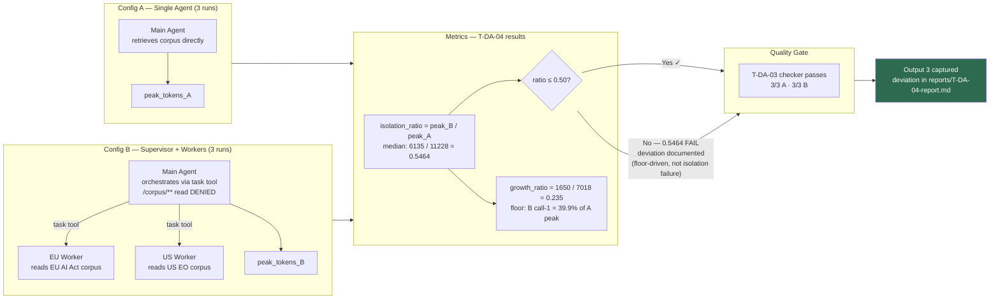
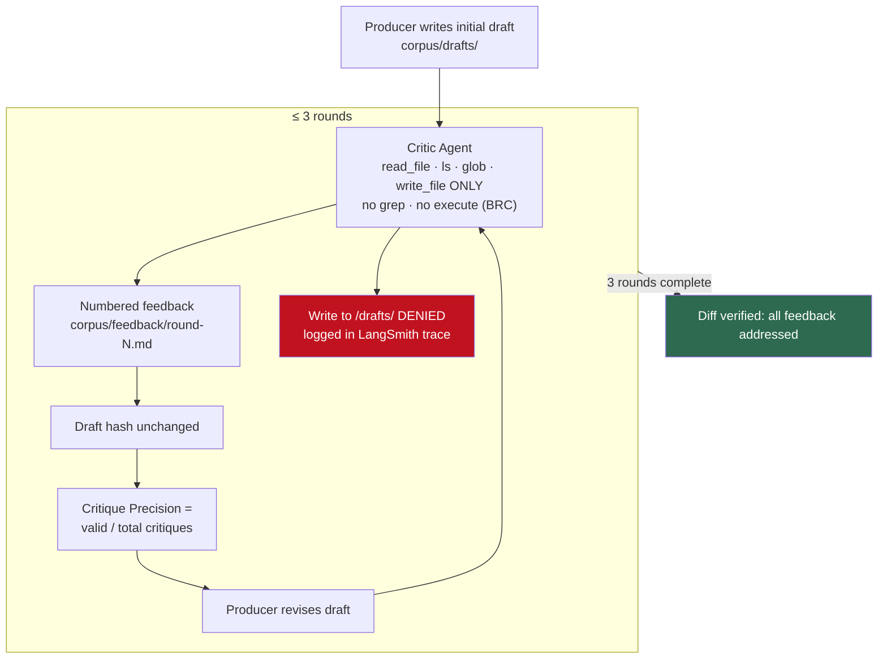
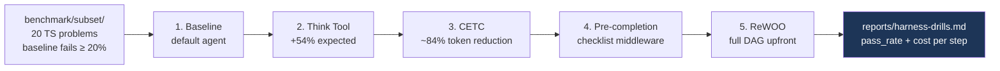
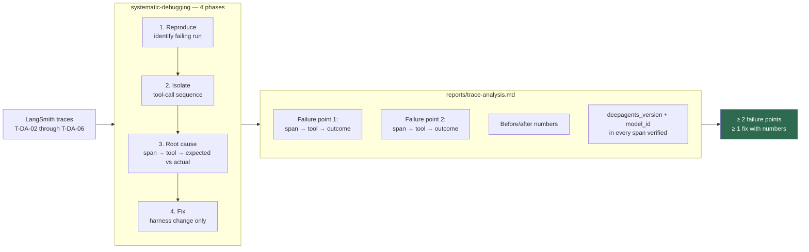

# Experiment Workflows — T-DA-04 through T-DA-07

## T-DA-04 — Context Isolation Proof (Output 3)

## T-DA-05 — Critique Workflow

## T-DA-06 — Harness Optimization Drills

## T-DA-07 — Trace Analysis

