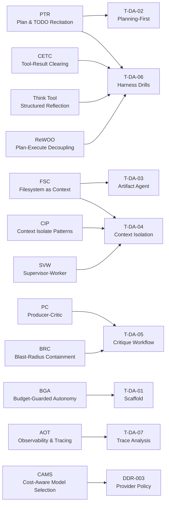

# Agentic Patterns

Which patterns from [agentic-design.ai/patterns](https://agentic-design.ai/patterns) apply to which tasks, and the measurable target for each.

## Pattern-to-Task Map

## Pattern Impact vs Effort

| Pattern    | Effort | Impact | Key metric                                                                                     |
| ---------- | ------ | ------ | ---------------------------------------------------------------------------------------------- |
| PTR        | Low    | High   | ≥8/10 first tool = `write_todos`                                                               |
| FSC        | Low    | High   | `/report/` files on disk, no content in messages                                               |
| BGA        | Low    | Medium | 4-dim counter: tokens / cost / ms / calls                                                      |
| BRC        | Low    | High   | adversarial write denied in LangSmith trace                                                    |
| AOT        | Low    | Medium | `deepagents_version` + `model_id` in every span                                                |
| Think Tool | Low    | High   | expected +54% on multi-step tasks                                                              |
| CETC       | Medium | High   | expected ~84% token reduction on long runs                                                     |
| CAMS       | Medium | Medium | GPT-5.4-mini primary; Groq single-call only                                                    |
| PC         | Medium | High   | Critique Precision = valid issues / total critiques                                            |
| CIP        | Medium | High   | isolation_ratio = peak_B / peak_A ≤ 0.50                                                       |
| ReWOO      | Medium | High   | model-call count reduction vs baseline                                                         |
| SVW        | High   | High   | ≤5 workers; B cost ~4% lower than A (corpus-carry saving 78K tokens offset by worker overhead) |

## Pattern Details + Metric Targets

| Pattern   | Task    | Implementation                                                                                                       | Target / Gate                                                                                     |
| --------- | ------- | -------------------------------------------------------------------------------------------------------------------- | ------------------------------------------------------------------------------------------------- |
| **PTR**   | T-DA-02 | System prompt: call `write_todos` before any other action                                                            | ≥8/10 runs first tool = `write_todos`; ≤10 todo items                                             |
| **FSC**   | T-DA-03 | `new FilesystemBackend()` — write large outputs to disk; keep only paths in messages                                 | `/report/` files exist; no raw content in agent messages                                          |
| **CIP**   | T-DA-04 | `task` tool via `SubAgentMiddleware` — spawns fresh-context sub-agent                                                | `main_peak_B / main_peak_A` ≤ 0.50 (v2 measured: 0.3286 PASS ✓; v1 0.5464 floor-driven deviation) |
| **BGA**   | T-DA-01 | `src/lib/counter.ts` pre-step hook — 4 dimensions checked before each agent step                                     | Unit test passes; real run logs all 4 dims                                                        |
| **BRC**   | T-DA-05 | `createFilesystemMiddleware({ tools: ["read_file","ls","glob","write_file"] })` for critic — no `grep`, no `execute` | Write attempt to `/drafts/` denied; logged in trace                                               |
| **PC**    | T-DA-05 | Separate `systemPrompt` for producer vs critic; numbered feedback items                                              | Critique Precision ≥ 0.6 per round; ≤3 rounds                                                     |
| **CETC**  | T-DA-06 | `clear_tool_uses_20250919` middleware — step 3 of harness drills                                                     | Token count drops ~84% vs baseline on long runs                                                   |
| **Think** | T-DA-06 | Custom `think` no-op tool + prompt examples — step 2 of harness drills                                               | Pass rate +54% vs baseline on multi-step problems                                                 |
| **SVW**   | T-DA-04 | `maxWorkers: 5` cap in config-b — avoid diminishing returns beyond threshold                                         | Sub-agent count ≤5; B cost $0.1849 vs A $0.1922 (~4% lower — corpus carry B/A = 0.317)            |
| **ReWOO** | T-DA-06 | System prompt forces full `write_todos` DAG upfront — step 5 of harness drills                                       | Model-call count reduction vs baseline measured                                                   |
| **AOT**   | T-DA-07 | `deepagents_version` + `model_id` in `runConfig.metadata` on every run                                               | Every LangSmith span contains both fields                                                         |
| **CAMS**  | DDR-003 | Provider: `openai:gpt-5.4-mini-2026-03-17` primary; Groq single-call only (DDR-003, DDR-012)                         | Never Qwen3 on Groq in loops; migration recorded in DDR-012                                       |
