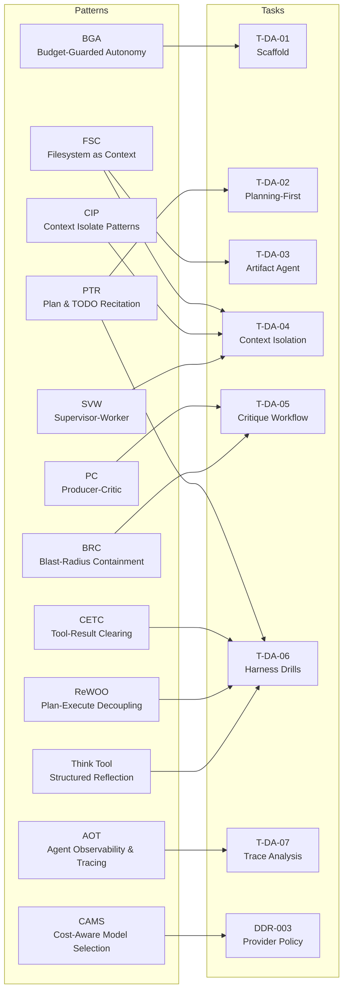
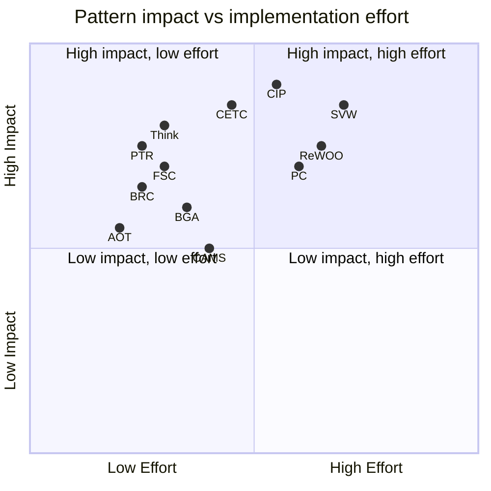
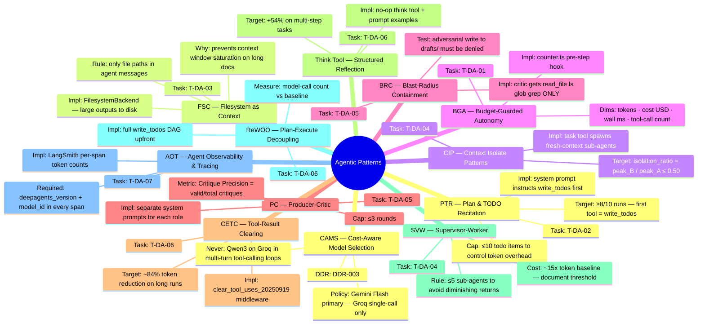

# Agentic Patterns

Which patterns from [agentic-design.ai/patterns](https://agentic-design.ai/patterns) apply to which tasks, and the measurable target for each.

## Pattern-to-Task Map

## Pattern Reference Card

## Pattern Details + Metric Targets

## Implementation Checklist by Pattern

| Pattern   | Where implemented                                              | Verified by                              |
| --------- | -------------------------------------------------------------- | ---------------------------------------- |
| **PTR**   | System prompt in `src/experiments/planning-first/treatment.ts` | ≥8/10 first-call rate in results         |
| **FSC**   | `new FilesystemBackend()` in `src/experiments/artifact-agent/` | `/report/` files on disk after run       |
| **CIP**   | `task` tool via SubAgentMiddleware (built-in)                  | isolation_ratio ≤ 0.50 in measure.ts     |
| **BGA**   | `src/lib/counter.ts` — pre-step hook in agent options          | unit test + real run logs                |
| **BRC**   | `createFilesystemMiddleware({ tools: [...] })` in critic.ts    | adversarial write denied in trace        |
| **PC**    | Separate `systemPrompt` strings for producer vs critic         | Critique Precision logged to LangSmith   |
| **CETC**  | `clear_tool_uses_20250919` middleware in harness step 3        | token count before/after in trace        |
| **Think** | Custom `think` tool added to agent in harness step 2           | pass rate delta in reports/              |
| **SVW**   | Worker count cap in config-b.ts: `maxWorkers: 5`               | sub-agent count in LangSmith spans       |
| **ReWOO** | System prompt forces full DAG in harness step 5                | model-call count reduction in reports/   |
| **AOT**   | `deepagents_version` + `model_id` in `runConfig.metadata`      | every span in LangSmith has these fields |
| **CAMS**  | Provider selection in `src/lib/models.ts` (T-DA-01)            | DDR-003 documents the policy             |
