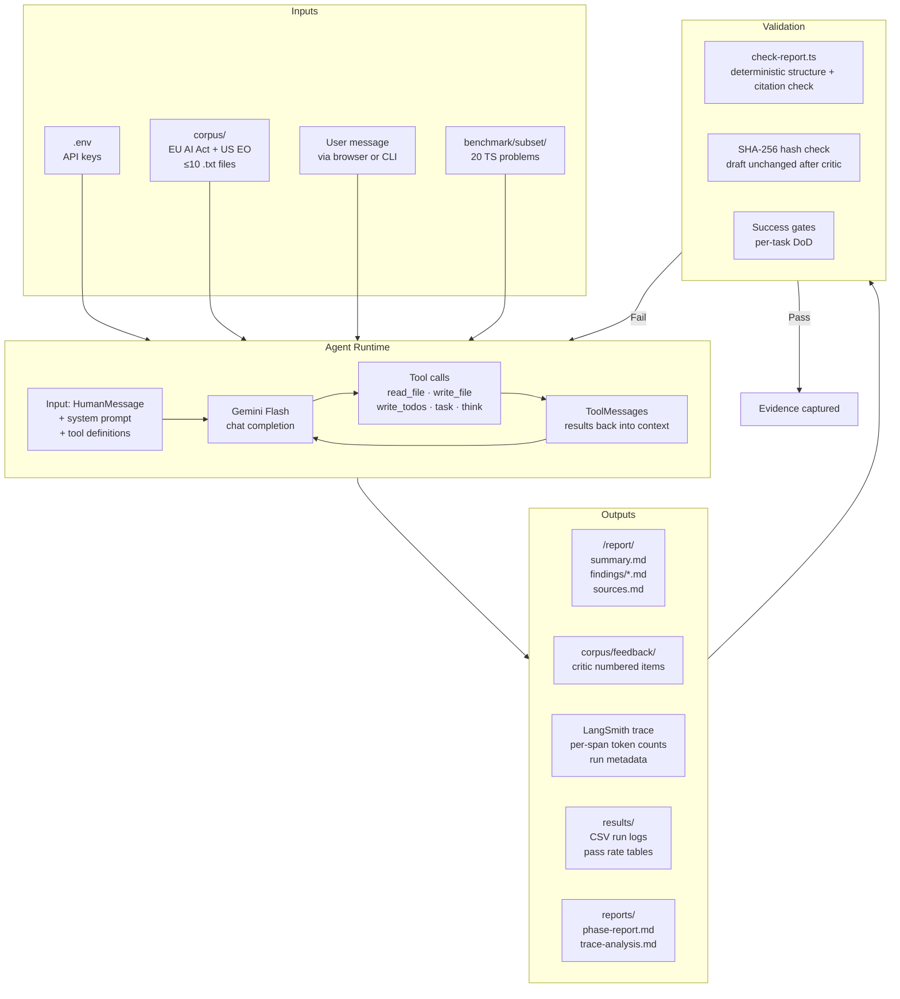
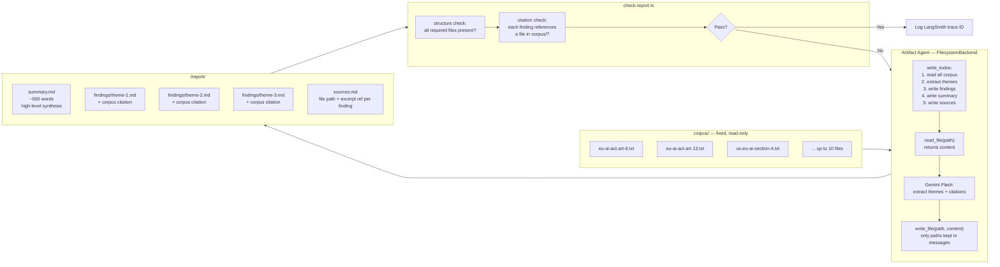
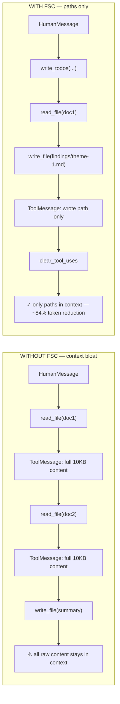
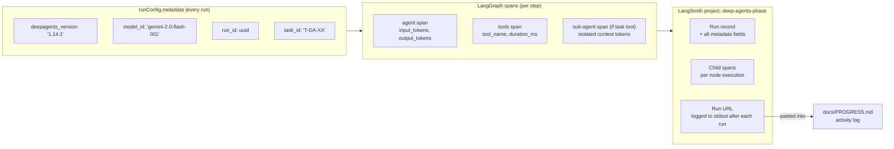
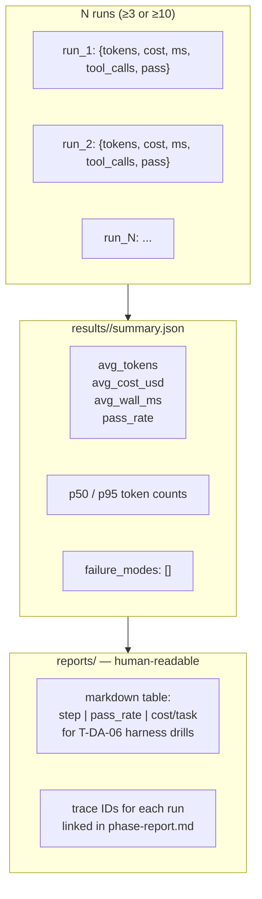

# Data Flow

How data moves through the system from input to output, per layer and per experiment.

## Overall Data Lifecycle

## Corpus → Artifact Agent → Report (T-DA-03 detail)

## Message Flow Inside the Graph (FSC pattern)

## Trace Data Flow (AOT pattern)

## Results Aggregation (per experiment)

